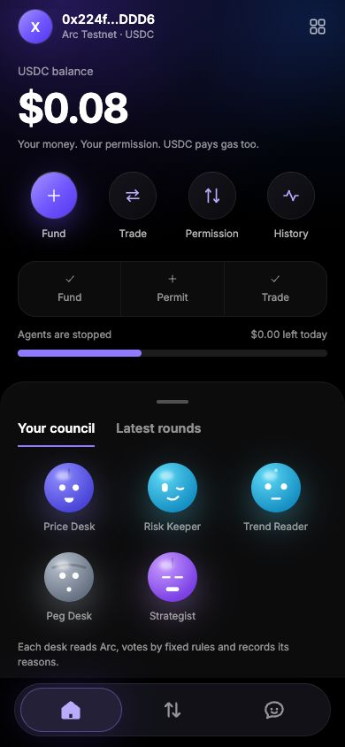
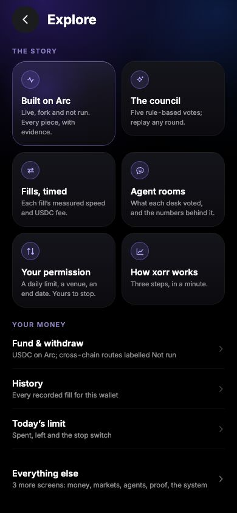
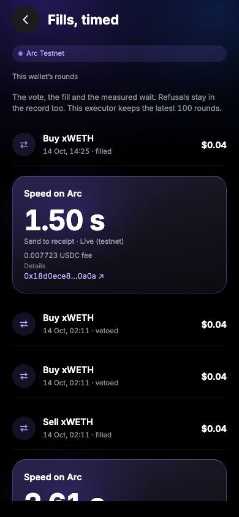

# XORR on Arc

Live: https://app-production-0530.up.railway.app (Arc testnet)


**A council of five rule-based agents trades for you inside an on-chain permission you can revoke in one tap.** You hold
only USDC. You grant a daily cap, a venue allowlist and an end date; every fill is floored at Chainlink's price on chain;
the CCIP receiver can take a stop sent from Base or Ethereum (not yet run over a live lane, see below). Arc takes its gas
in the same USDC and finalizes deterministically.

The council seats (Price Desk, Risk Keeper, Trend Reader, Peg Desk, Strategist) are **deterministic rules over what was read
that round, not an LLM and not machine learning**: every vote names the numbers it rests on, so you can check it against
the stored inputs. Each seat is an ERC-8004 agent on Arc that earns reputation from how its votes turned out against
Chainlink.

**What has actually run** (labels used everywhere below: **Live** = real transactions on Arc testnet, **Fork** = a local
fork of Arc mainnet, **Not run**):

- **Live, Arc testnet:** the contracts are deployed (`deployments/arc-testnet.json`) and the core loop ran with real
  transactions (`docs/E2E-TESTNET.md`): grant, council, a Memo-tagged trade inside the cap with the price floor, an
  over-cap round vetoed, a mined over-cap revert, a mined price-floor revert, revoke, a mined post-revoke revert.
- **Fork, Arc mainnet:** the same loop on the real Uniswap v3 pools and real Chainlink feeds (`docs/E2E-FORK.md`).
- **Not run:** Circle Gateway, CCTP V2, USYC, and a CCIP stop sent from another chain.
- **Testnet is XORR-seeded.** Arc testnet has no Uniswap and no Chainlink feeds. The testnet build deploys Uniswap v2 from
  published bytecode with about 5 USDC per pool for test tokens (xWETH, xcirBTC), and prices them with mirror feeds of
  Chainlink's Arc mainnet answers. Trades there are cents. The USDC/EURC pool is not seeded (no testnet EURC). Mainnet
  uses none of this: real Uniswap v3 pools and real Chainlink feeds.

## Arc stack

| Piece | What it does in XORR | Where | Status |
|---|---|---|---|
| USDC as gas, deterministic finality | One token pays for trades and gas | everywhere | **Live** (testnet buys confirmed in 1.6-2.6 s end to end, gas estimate and receipt polling included); **Fork** (~0.6 s). Sub-second finality is Arc's documented property, not something XORR measured |
| Chainlink Data Feeds on Arc | Council prices and the **on-chain floor under every fill** | `XorrPriceGuard`, `XorrDelegation` | **Fork**: the real mainnet feeds; unit tests (stale feed, exact boundary, far-below-oracle fill refused). **Live**: on testnet the feeds are XORR **mirrors** of the mainnet answers, and the floor refused a fill on chain (`BelowOracleFloor`) |
| Uniswap | The venue | `XorrVenueRegistry`, `docs/VENUES.md` | **Fork**: real Uniswap v3 pools on mainnet (USDC/cirBTC, USDC/EURC, thin USDC/WETH). **Live**: XORR-seeded Uniswap v2 test pools on testnet |
| ERC-8004 identity + reputation | Five council seats registered; `settle` writes each seat's score | `XorrCouncil` | **Live**: five seats registered on testnet. **Fork**: reputation writes. Testnet settlement is possible one hour after a round (`docs/E2E-TESTNET.md` says whether it ran) |
| Chainlink CCIP | Cross-chain kill switch: a Base/Ethereum transaction reaches your Arc permission | `XorrStopSender`, `XorrStopReceiver` | Receiver **Live** on testnet; the cross-chain path is **Not run** over a live lane (Chainlink Local tests only) |
| Arc Memo | Each agent trade is sent through Memo with the council decision id as memo id | `server/src/chain.ts` | **Live** on testnet (trade tagged, see `docs/E2E-TESTNET.md`); **Fork** with Arc Foundry |
| EURC | FX desk (USDC/EURC pool, EUR/USD feed) | council, `app/markets` | **Fork**: bought on the real pool. Testnet: pool not seeded, **not traded** |
| Circle Gateway, CCTP V2, USYC | Fund from any chain, withdraw to Base/Ethereum, park idle USDC | `server/src/gateway.ts`, `app/fund`, `app/treasury` | **Not run.** Default off (`FEATURE_GATEWAY`, `FEATURE_CCTP`, `FEATURE_USYC`): they need Circle's live services or an entitled wallet |

## The app

The finished XORR Expo interface is now on Arc: a balance-led home, round quick actions, an agent sheet,
Explore story tiles, council voting and replay, agent rooms, history and timed receipts. Rooms show recorded
rule-based ballots, not LLM conversations. Perps and the source chain's strategy gauntlet are omitted because
this deployment has no supporting Arc venue or backtest dataset. [Port and verification notes](docs/UI-PORT.md).

| Home | Explore | Timed fills |
|---|---|---|
|  |  |  |

[Desktop view](docs/screens/testnet/home-1280.jpg) · [All screens at 1280 and 390px](docs/screens/testnet/)

The browser rehearsal granted a 0.10 USDC daily limit, convened the council, bought 0.04 USDC of xWETH in the
XORR-seeded testnet pool, and revoked the permission. The trade's measured send-to-receipt time was 1.50 s;
its on-chain gas fee was 0.007723 USDC. [Transactions and budget](docs/UI-BROWSER-TESTNET.json).

## The permission

`XorrDelegation.grant(agent, dailyCapUsdc, expires, slippageBps, venues[])`, owner only. The agent can call
`spend(...)` and nothing else; it cannot exceed the cap (resets 00:00 UTC), use a venue the owner did not allow (and the
registry still lists), trade after expiry, or accept an output below Chainlink's price minus the owner's slippage. The
contract holds nothing and has no admin. `revoke()` stops every agent at once; guardians (the CCIP receiver) can only stop.

## Venue findings (2026-10-08, see `docs/VENUES.md`)

Uniswap v2, v3 and v4 are officially deployed on Arc mainnet. XORR trades through v3 SwapRouter02 because its pools hold
real liquidity (cirBTC about 6M USDC deep, EURC about 9k, WETH only about 600 USDC, so WETH rounds stay tiny and the
Chainlink floor refuses fills the pool depth would push past your slippage). Arc testnet has no Uniswap, so the testnet
build deploys Uniswap v2 from its published bytecode with XORR test tokens, labelled as such. No perps venue exists on
Arc, so XORR does not offer perps.

## Run and test

```sh
npm ci && npm --prefix server ci && (cd contracts && sh setup.sh && npm ci)
npm run typecheck && npm --prefix server run typecheck
npm test                      # app + executor unit tests (vitest)
(cd contracts && forge test)  # contracts: unit, fuzz, invariant, Chainlink Local CCIP
npm run e2e:fork              # the whole loop on a local fork of Arc mainnet; writes docs/E2E-FORK.md
npm run e2e:testnet           # the loop on live Arc testnet (needs a funded throwaway owner, see the script header); writes docs/E2E-TESTNET.md
npm run build:web             # static web export to dist-web
npm --prefix server run build # compiled executor under server/dist
```

Local app: `sh scripts/arc-fork.sh mainnet` (fork + deploy), then
`XORR_NETWORK=arc-mainnet ARC_RPC_URL=http://127.0.0.1:9110 XORR_DEPLOYMENT=.fork/arc-mainnet-fork.json XORR_EXECUTOR_KEY_FILE=.fork/keys.env npm run server`
and `npm run web` (port 9130). With no deployment or wallet the app still loads and says so. The fork scripts use stock
Foundry by default (a USDC stand-in is placed over `0x3600…`, see `docs/E2E-FORK.md`); set `ARC_FOUNDRY` to Circle's
Arc Foundry for the real precompiles.

Fork-only Solidity tests (`contracts/test/fork`, opt-in `ARC_FORK_TESTS=1`) need Arc Foundry's `forge --network arc`.

## Layout

`contracts/` Foundry project · `server/` Hono executor (council, rounds, keeper) · `app/`, `src/` Expo web app ·
`scripts/` fork, deploy and e2e · `deployments/` per-network addresses · `docs/` venue research, e2e record, walkthrough.
Deploying to mainnet: `MAINNET.md`. Hackathon text: `SUBMISSION.md`.

## Status

Deployed on **Arc testnet** (`deployments/arc-testnet.json`: XorrDelegation, price guard with mirror feeds, venue registry,
council ledger, five ERC-8004 seats, CCIP stop receiver). Not deployed to mainnet yet: `deployments/arc-mainnet.json` is
written by `scripts/deploy.sh mainnet` and `MAINNET.md` lists the steps and caps. Signed round and autopilot requests are
replay-protected (`signed-requests.json` under the data dir; keep it on persistent storage and run one executor writer per
data directory). Not audited. See `docs/JUDGE-REPORT.md` for the claims audit.
